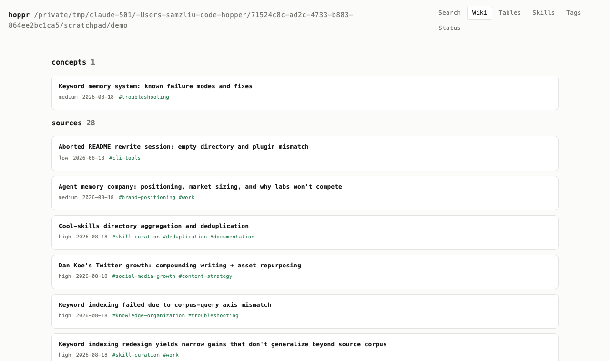
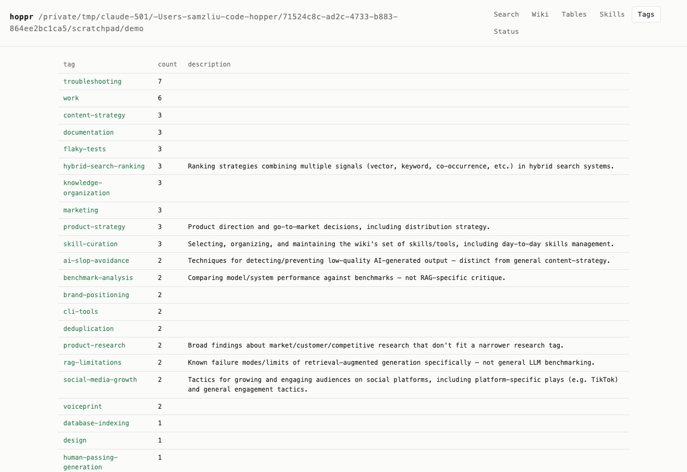
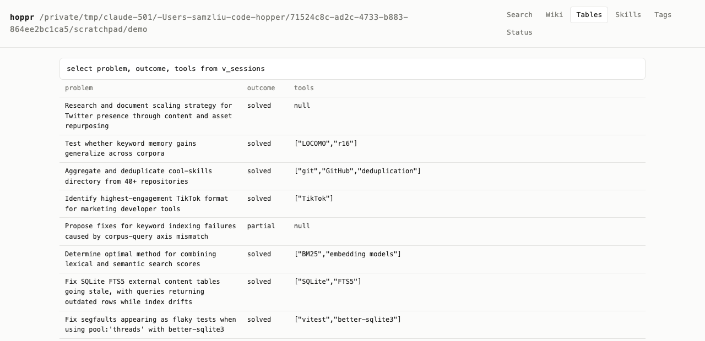
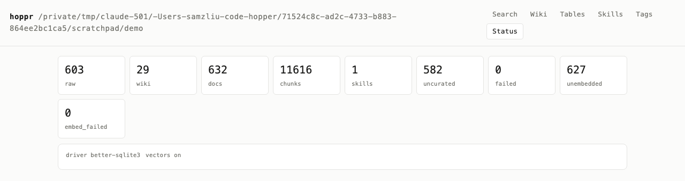

# hoppr

[](https://github.com/Fergana-Labs/hoppr/actions/workflows/ci.yml)
[](package.json)
[](LICENSE)

**Turn any folder into queryable, structured context your agents can understand.** Run hoppr in a directory of
papers, notes, screenshots, downloads, or agent transcripts. It leaves the original
files alone and adds hybrid search, an LLM wiki, structured tables, a knowledge graph, or skills.

A folder is already a useful boundary: it contains material about a project, subject, or
part of your life. hoppr makes that material searchable and gives agents
a structured way to work with it and build a compounding asset.

```bash
cd ~/Downloads
npx hoppr init
```

Like `git init`, `hoppr init` creates a hidden directory in the folder where you run it.
Your files stay where they are and are never edited or written to.



> Your folder remains the source of truth. `.hoppr/` contains the search index and
> generated structure. No hosted database or always-on service is required.

## Use it on the folders you already have

| folder | what hoppr adds |
|---|---|
| research papers | searchable PDF text, summaries, recurring concepts, and a typed graph |
| `~/Downloads` | OCR and text extraction across mixed files, with one search interface |
| screenshots | local OCR, optional visual descriptions, and search over text inside images |
| an Obsidian vault | hybrid search and generated concept pages alongside the existing Markdown graph |
| coding-agent history | durable memory and compounding skills across Claude Code, Codex, opencode, and openclaw sessions |

```bash
cd ~/research/my-field && hoppr init --curation papers
cd ~/Downloads && hoppr init --curation index-only
cd ~/Desktop/Screenshots && hoppr init
cd ~/vault && hoppr init --curation notes

# Agent memory is another source, not a separate product:
hoppr init --from agents:claude-code,codex --global --name work
```

## What you get

```text
my-folder/               the folder is the raw tier; your files stay put
├── meeting-notes.md
├── paper.pdf
├── screenshot.png
└── .hoppr/
    ├── curated/
    │   ├── wiki/        source pages + concepts + wikilinks
    │   ├── tables/      structured JSONL with source traces
    │   ├── graph/       typed entities + cited edges as grep-friendly JSONL
    │   ├── skills/      optional procedures distilled from agent logs
    │   └── prompts/     editable curation instructions
    ├── schemas/         graph / wiki / skills, when they outgrow one file
    ├── .index/          BM25 + vector search
    ├── .env             API keys, gitignored
    ├── CLAUDE.md        the store contract for filesystem agents
    └── hoppr.toml       source and curation settings
```

For a directory source, the folder itself is the raw tier; there is no duplicate `raw/`
directory. `.hoppr/raw/` is used for durable captures from connector-owned sources such
as coding-agent session histories.

- **Search everything together.** BM25 and local vector search are fused with RRF. Results
  can mix original files, wiki pages, table rows, and skills; `--scope curated` and
  `--scope raw` narrow the search when you need them.
- **Build a wiki from a folder.** Fast passes write source pages; deep passes merge
  recurring ideas into concepts and converge the tag vocabulary.
- **Extract rows, not just summaries.** Define a table once and new matching captures
  populate it on later passes. Every cell retains its source.
- **Review every generated change.** Curated output is Markdown and JSONL in Git. hoppr
  commits each curation pass so you can diff or revert it.
- **Configure the whole pipeline.** Choose what is indexed, what can be sent to a model,
  which artifacts are generated, their schemas and prompts, and which models do the work.
- **Keep the source folder untouched.** hoppr writes only inside `.hoppr/` for ordinary
  directory sources.

## Try it in 60 seconds

Requires Node 20.11 or later.

```bash
npm install -g hoppr       # or prefix commands with npx

cd ~/research/my-field
hoppr init -y
hoppr search "papers that challenge retrieval-augmented generation"
```

A hoppr works like a Git repository: commands run in nested directories find the nearest
`.hoppr/` by walking up the tree.

Keep adding supported files to the folder as usual. `hoppr sync` picks them up on demand;
the optional daemon watches for changes and indexes them in the background. There is no
separate import directory for ordinary folder sources.

Or point a globally registered hoppr at material elsewhere:

```bash
hoppr init --global --name papers --from dir:~/research --curation papers
hoppr init --global --name archive --from dir:~/Archive --curation index-only
hoppr init --global --name work --from agents:claude-code,codex
```

Folder sources stay in place. Agent connectors instead store a redacted, normalized
Markdown snapshot of each session because harness-owned logs may later change or disappear.

## Search the folder, not the file names

```bash
hoppr search "papers that disagree about scaling laws"
hoppr search "the receipt for the monitor"       # source + generated artifacts by default
hoppr search "whiteboard photo about onboarding" --since 30d
hoppr search "the flaky test fix involving fake timers" --explain
```

All artifact types share one keyword index and, when enabled, one vector index. Filters
run before ranking. If a raw capture has a curated page, the two collapse into one result
instead of competing.

Connect it to an agent:

```bash
hoppr mcp install                    # agent can select any registered hoppr
hoppr -H work mcp install --pinned  # expose only the work store
hoppr mcp status --probe
```

The MCP server is a stdio process launched by the client. It opens SQLite directly, so it
does not depend on the daemon.

Agents do not need MCP to use a hoppr. The store is a normal directory: they can `rg`
the Markdown wiki, read source paths, or inspect `curated/graph/*.jsonl` directly. MCP
adds ranked search and graph traversal; it is not a filesystem abstraction or security
boundary.

## Start with a preset, then change anything

| preset | builds | model calls |
|---|---|---|
| `notes` | source pages and cross-document concepts | yes |
| `papers` | one summarized page per document | yes |
| `agents` | pages, concepts, and proposed skills | yes |
| `index-only` | keyword and vector search | no |
| `minimal` | keyword search only | no |

Presets are starting points, not locked modes. The individual layers remain configurable:

- `hoppr.toml` controls retrieval, extraction, curation, scheduling, models, and Git.
- `.hopprignore` separates files to skip from files to index without model access.
- `.hoppr/curated/tables/` contains standing table schemas.
- `.hoppr/schemas/` defines wiki outlines, entity types, relationships, and skill settings.
- `.hoppr/curated/prompts/` contains the editable prompts used during curation.
- Hand-edited generated pages and rows are pinned instead of overwritten.

```toml
[retrieval]
embeddings = true
graph = true

[retrieval.extract]
ocr = true
image_llm = false
pdf = true
pdf_ocr = true
office = true

[llm]
fast_provider = "openrouter"
quality_provider = "ollama"
```

The wiki follows
[Karpathy's LLM wiki specification](https://gist.github.com/karpathy/442a6bf555914893e9891c11519de94f),
including Markdown pages, frontmatter, `[[wikilinks]]`, a generated catalog, and an
append-only operation log. Open `curated/wiki/` directly in Obsidian or let an agent
navigate it as files.

The optional knowledge graph follows the same rule. `hoppr graph build` writes typed
entities to `curated/graph/nodes.jsonl` and cited relationships to
`curated/graph/edges.jsonl`. Search those files with `rg`, use `hoppr graph show <name>`
for one-hop traversal, or let an MCP agent call `hoppr_graph_search` and
`hoppr_graph_show`. Every edge carries an evidence quote and source id.

<details>
<summary><strong>See the wiki, tags, tables, and status dashboard</strong></summary>

### Wiki


### Tags



### Tables



### Status



</details>

## Structured extraction

Define a standing table schema:

```toml
# .hoppr/curated/tables/meetings.table.toml
match = "scope:raw"

[columns]
date = { type = "date", required = true }
attendees = { type = "list[string]" }
outcome = { type = "enum", values = ["solved", "partial", "abandoned"], converging = true }
```

Then query it:

```bash
hoppr tables rebuild meetings
hoppr table meetings --trace
hoppr sql "select outcome, count(*) from v_meetings group by outcome"
```

Rows are exported as JSONL. Manual edits pin the row, so later extraction preserves your
changes. `converging = true` reuses existing values as preferred vocabulary.

## Optional: turn agent history into reusable skills

The deep pass groups transcripts by procedural similarity: repeated tool sequences,
recurring failures, and fixes that worked.

```bash
hoppr deep
hoppr skills review
hoppr skills why debug-flaky-vitest
hoppr skills install debug-flaky-vitest
```

hoppr never auto-installs a skill. Proposals require explicit acceptance and installation,
and rejected proposals are remembered.

## What hoppr can read

hoppr can index prose, HTML, JSON, YAML, CSV, PDF, Word, Excel, PowerPoint, and common
image formats. Images use local OCR for searchable text and an optional vision model for
visual description. Scanned PDFs use OCR on the first five pages.

```gitignore
# .hopprignore
secret/              # never index
*.zip

[no-curate]
archive/**            # searchable, never sent to a model
*.csv
```

Extraction failures are isolated to the affected file and fall back to indexing its name
and path. See [supported inputs](docs/FILE-TYPES.md) for exact formats and fallbacks.

## Local-first by construction

```text
raw input  ──curate──>  curated/  ──index──>  .index/
never rewritten         Git-tracked            rebuildable
```

- A directory source is indexed in place and never opened for writing.
- Agent sessions are stored as normalized snapshots in `.hoppr/raw/`; ordinary folder
  sources are referenced where they already live.
- Curated Markdown, tables, and skills are tracked in Git.
- Search indexes and embedding caches are rebuildable.
- A single optional daemon watches every registered store; CLI and MCP access work
  without it.

hoppr does not scrape the web or connect to external accounts. Designs for arXiv,
YouTube, bookmarks, iMessage, and platform exports live in
[Future sources](docs/FUTURE-SOURCES.md), outside the core package.

## Models and cost control

Keyword search needs no model or optional dependency. Local embeddings add semantic
search. Curation needs either a supported API key or Ollama.

```bash
export OPENROUTER_API_KEY=...
```

```toml
[llm]
fast_provider = "openrouter"    # tagging and extraction
quality_provider = "anthropic"  # synthesis and skill mining
```

`index-only` makes no model calls. `[no-curate]` keeps selected files searchable without
sending them to a model. Set `[llm] provider = "ollama"` to keep curation local.

Configuration precedence:

```text
defaults < ~/.hoppr/hoppr.toml < <store>/hoppr.toml < HOPPR_* environment < CLI flags
```

Keep API keys in the environment, `~/.hoppr/.env`, or `<store>/.env`, not in
`hoppr.toml`. `hoppr doctor` reports the active provider, model, and key source.

## Security

Folders and agent logs may contain pasted keys or echoed `.env` files. hoppr redacts
recognized credentials before extracted text is indexed, embedded, committed, or sent
to a model. The original source is never modified.

Built-in redaction covers common vendor tokens, private keys, bearer tokens, JWTs,
credentials in URLs, suspicious assignments, and an entropy-based fallback. It reduces
accidental exposure but cannot make an untrusted corpus safe to publish.

## Commands

```text
hoppr init | setup | doctor
hoppr add | sync | search | get | related
hoppr index | curate | deep | reindex | embed | catalog
hoppr tables | table | sql | graph
hoppr skills | prompts | journal | undo
hoppr mcp | vfs | daemon | web | browse
```

See the [command reference](docs/COMMANDS.md) for every command, flag, configuration key,
and environment variable.

## Documentation

- [Command reference](docs/COMMANDS.md)
- [Supported inputs and redaction](docs/FILE-TYPES.md)
- [Complete configuration examples](docs/examples/)
- [Future source designs](docs/FUTURE-SOURCES.md)

## Development

```bash
npm install
npm run check
npm run e2e
npm run hoppr -- --help
```

## License

MIT
